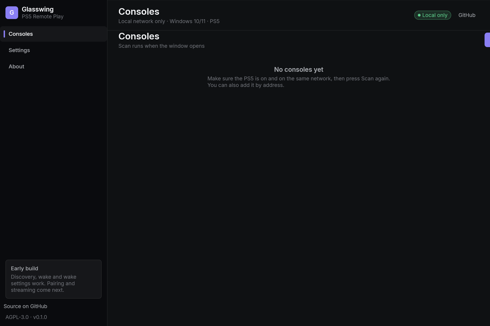
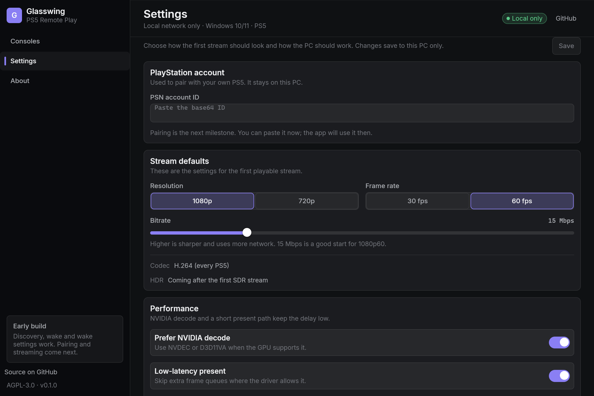
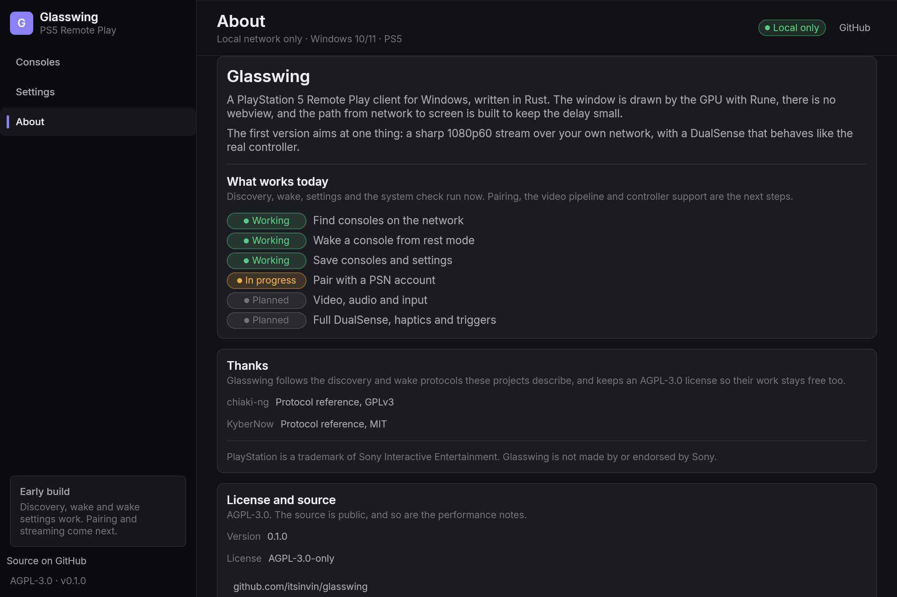

# Glasswing

**A low-delay PS5 Remote Play app for Windows.**

Glasswing is a free, open-source app that lets you play your own PS5 on your
own PC over your home network. It is written in Rust from top to bottom. The
window is native Rust drawn by the GPU with [Rune](https://github.com/anomalyco/rune)
— no webview, no browser engine, no JavaScript anywhere in it.

> **Early build.** Right now Glasswing can find your PS5 on the network, save
> it, wake it, and check that your PC is ready. Pairing and game streaming are
> the next steps. It cannot stream a game yet.

The name comes from "glass to glass" — the time it takes a picture to go from
the console's screen to your eyes. A glasswing butterfly has clear wings. It
felt like a good fit.

| Consoles | Settings | About |
|---|---|---|
|  |  |  |

## What works today

- Find PS5 consoles on your local network with a UDP scan.
- Show each console's name, address, state, firmware, and running game.
- Save consoles, including ones you add by IP address.
- Wake a console from rest mode.
- Save stream defaults: 1080p or 720p, 30 or 60 fps, 5–50 Mbps, H.264.
- Check for an NVIDIA GPU, FFmpeg, and the NVDEC decoder.
- Keep settings in a plain TOML file on your PC.

## What comes next

| Step | What it adds |
|---|---|
| Pairing | PSN account ID, PIN pairing, and a saved console key |
| Session | Request a session, open the control channel, get a stream URL |
| Stream core | Takion, crypto, FEC, and frame assembly |
| First stream | H.264 decode, wgpu render, Opus audio, controller input |
| DualSense | Rumble, adaptive triggers, touchpad, gyro, lightbar, HD haptics |
| Polish | Stats overlay, recovery, installer, latency tuning |

## Build it

You need:

- Windows 10 or 11 (64-bit)
- Rust stable (1.85 or newer) on the MSVC toolchain
- A GPU — any DirectX 12 card works; an NVIDIA card is best, since that is
  where video decode will go first

```powershell
cargo run -p glasswing-app
```

The first Rust build takes a while, because Rune and its GPU stack are built
from source. Later builds are much faster.

### Headless snapshots

Every page can be drawn without a window, which is handy for checking a change
or for CI:

```powershell
cargo run -p glasswing-app -- --snap target\consoles.png --scene consoles
cargo run -p glasswing-app -- --snap target\settings.png --scene settings
cargo run -p glasswing-app -- --snap target\about.png --scene about
```

## Command line

The small `gw` tool is useful for testing without the window:

```powershell
cargo run -p glasswing-cli -- discover
cargo run -p glasswing-cli -- discover --wait 5
cargo run -p glasswing-cli -- doctor
```

After a release build, the binary is `target\release\gw.exe`.

## How discovery works

Glasswing sends a short text packet to UDP port **9302** on your local
network. A PS5 answers with its name, address, state, and the game that is
running. Nothing goes to the internet.

Wake uses a second packet. It needs the pairing key from the console, so wake
will only work fully after pairing is built.

## NVIDIA and low delay

The first stream will use this plan:

- **NVDEC** for H.264 decode (through FFmpeg's `h264_cuvid` or D3D11VA).
- **wgpu on DX12** with the high-performance GPU selected.
- **Latest frame wins** — old frames are dropped, not queued.
- **No async in the hot path** — network, decode, render, and audio each get
  their own thread.
- **PresentMon** to measure real delay, not guesses.

The app already checks for an NVIDIA GPU and NVDEC. See
[docs/PERFORMANCE.md](docs/PERFORMANCE.md) for the full tuning notes.

## Project layout

```
crates/glasswing-core/   protocol and settings, no window needed
crates/glasswing-cli/    the `gw` command line tool
crates/glasswing-app/    the desktop app: a native Rune window
docs/                    protocol and performance notes
```

## Privacy

- No telemetry.
- No cloud account.
- No Sony credentials are bundled.
- Settings and logs stay in `%APPDATA%\Glasswing`.

## License

Glasswing is licensed under the **GNU Affero General Public License v3.0**.
See [LICENSE](LICENSE) and [NOTICE](NOTICE).

Protocol research is based on:

- [chiaki-ng](https://github.com/chiaki-ng/chiaki-ng) (AGPL-3.0)
- [KyberNow](https://github.com/MonsieurNours/kybernow) (AGPL-3.0)

The window is built with [Rune](https://github.com/anomalyco/rune) (MIT).

## Disclaimer

Glasswing is not affiliated with or endorsed by Sony. PlayStation and
DualSense are trademarks of Sony. Use Glasswing only with consoles, games, and
accounts that you own.